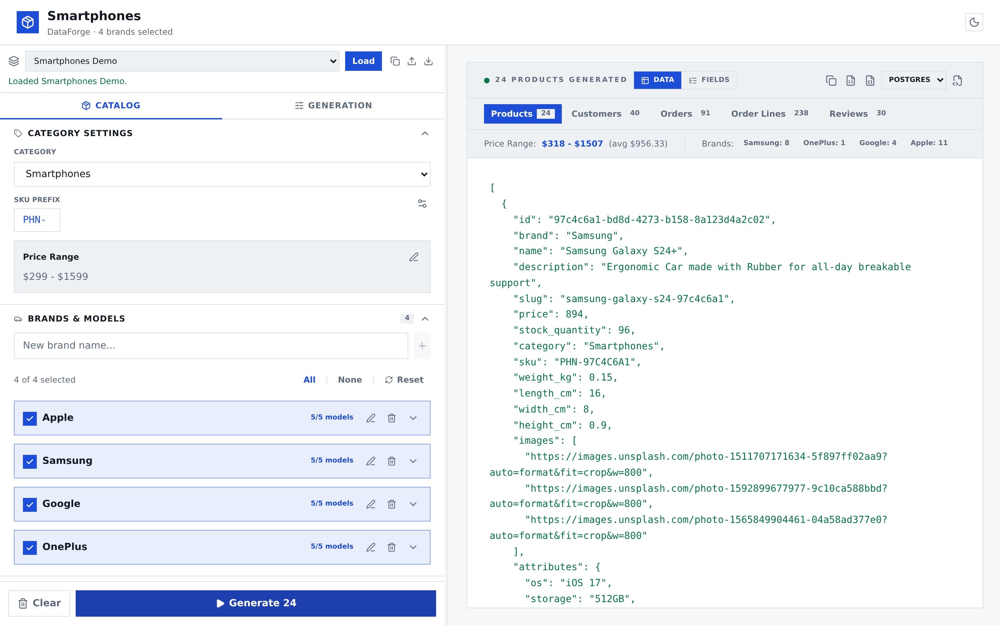
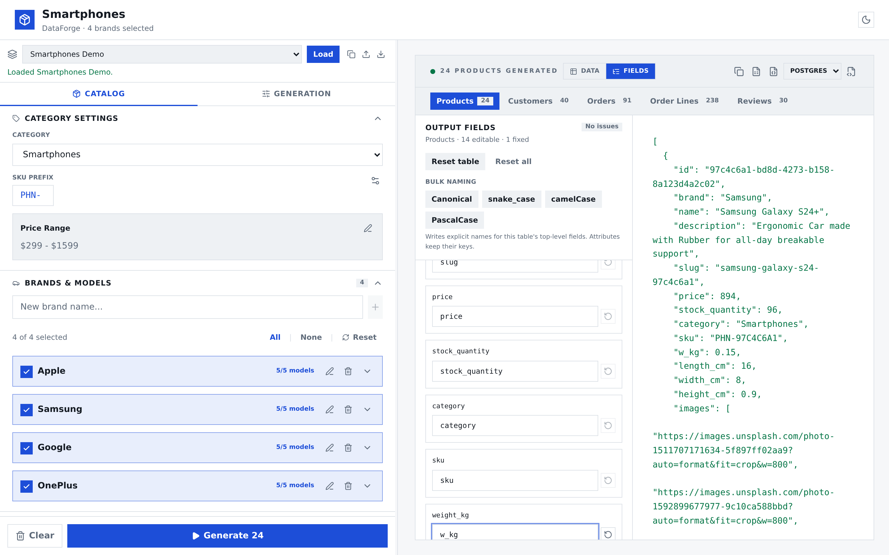
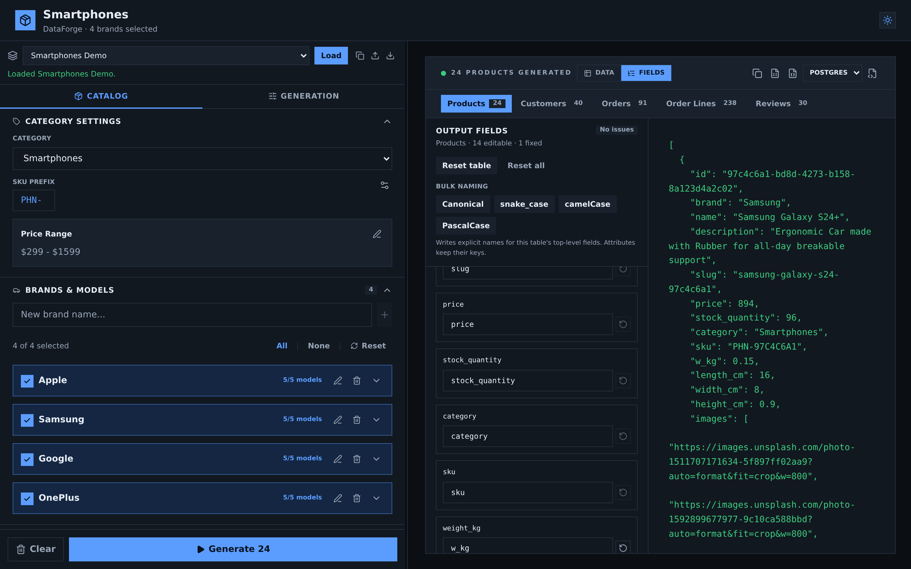

# DataForge

**Generate realistic, reproducible e-commerce seed data in the browser.**

[Live demo](https://juhonis.github.io/DataForge/) · [Architecture](docs/architecture.md) · [MIT License](LICENSE)



DataForge is a client-side seed data generator for storefront demos, fixtures,
and database experiments. Pick a category, tune its catalog and generation
settings, then export a coherent relational dataset as JSON, CSV, or SQL. No
backend, account, or upload is involved.

## Why I built it

DataForge started as a small side project while I was building **I Love
Shopping**, a full-stack B2C e-commerce platform for a six-month school project.
I needed realistic products, customers, orders, and reviews that referenced each
other correctly, so I built a small generator I could configure and rerun
locally. That use case still shapes DataForge today: relational output,
reproducible seeds, and exports that fit a real JSON, CSV, or SQL workflow.

## Features

- **Six built-in category templates** — smartphones, laptops, audio,
  accessories, books, and clothing.
- **Catalog control** — edit brands, models, brand weights, price overrides,
  category pricing, SKUs, ID formats, and typed attributes.
- **Seeded generation** — configure product, customer, order, and review counts
  with a reproducible random seed.
- **Five related tables** — products, customers, orders, order lines, and
  reviews, with consistent IDs and foreign keys.
- **Live JSON preview** and per-table clipboard copy.
- **Output field renaming** — rename top-level fields for every table, apply
  bulk `snake_case` / `camelCase` / `PascalCase` naming, and validate collisions
  before exporting.
- **JSON, CSV, and SQL exports** — full-dataset JSON, active-table CSV with
  flattened `attr_*` columns, and Postgres or MySQL `INSERT` scripts.
- **Presets** — load bundled demos or import/export a complete configuration,
  including field mappings.
- **Responsive workspace** — docked, resizable configuration pane on desktop and
  a drawer on smaller screens.
- **Light and dark themes** — both persisted locally.
- **Fully client-side** — configuration and theme persist in `localStorage`;
  generated data never leaves the browser.

## Screenshots

| Output field mapping | Dark theme |
| --- | --- |
|  |  |

## Quick start

Requirements: **Node.js 22+** and npm.

```bash
git clone git@github.com:juhonis/DataForge.git
cd DataForge/application
npm install
npm run dev
```

Open the URL printed by Vite—typically
`http://localhost:5173/DataForge/`.

### Docker

```bash
docker compose up --build
```

Open `http://localhost:5173/DataForge/`. The Docker setup runs the Vite
development server with the repository mounted for live reload.

## How it works

1. **Choose a category template** and customize its brands, models, pricing, and
   attributes.
2. **Set generation options** — product count, seed, customers, orders per
   customer, and reviews.
3. **Preview and inspect** the generated tables.
4. **Rename output fields** if you need a different JSON/CSV/SQL schema.
5. **Export** the dataset or save the whole configuration as a preset.

The catalog is declarative. A category template describes its brands, model
names, price ranges, dimensions, attributes, and product-name template; the
generators turn that specification plus a seed into data. See
[`application/src/core/categories.ts`](application/src/core/categories.ts) and
[`docs/architecture.md`](docs/architecture.md).

### Dataset model

| Table | Purpose |
| --- | --- |
| `products` | Catalog rows with brand, price, stock, SKU, dimensions, images, and attributes |
| `customers` | Customer identity and location data |
| `orders` | One row per order, linked to `customers.id` |
| `order_lines` | Products and quantities belonging to each order |
| `reviews` | Product reviews linked to both products and customers |

IDs remain stable across tables, so the exported relationships stay valid even
when output field names are remapped.

### Reproducibility

The same seed and configuration reproduce the same catalog and relationships.
Timestamp fields are anchored to the generation time, so their values naturally
differ between runs made at different times.

## Output formats

| Export | Contents |
| --- | --- |
| JSON | Full dataset keyed by the five tables, or copy the active table |
| CSV | Active table only; product attributes are flattened into `attr_<key>` columns |
| SQL | Full dataset as `INSERT` statements for PostgreSQL or MySQL |

Output mappings apply consistently to preview, clipboard, JSON, CSV, and SQL.
Table names stay canonical, and `attributes` remains a fixed container. Invalid,
blank, duplicate, reserved, or collision-causing field names are surfaced in the
Fields inspector and block data export until fixed.

Presets use format version 2. Version 1 presets and persisted configurations are
migrated automatically with an identity field mapping.

## Development

```bash
cd application
npm run dev        # development server
npm run lint       # ESLint
npm run typecheck  # TypeScript project build
npm test           # Vitest suite
npm run build      # production build in application/dist
```

The test suite covers generators, exporters, output-schema validation and case
conversion, presets, store migrations, theme handling, and resizer math.

## Project structure

```text
DataForge/
├── application/              React + TypeScript + Vite app
│   ├── public/               favicon and social preview image
│   └── src/
│       ├── components/       UI primitives and feature components
│       ├── core/             pure generation, mapping, preset, and export logic
│       ├── lib/              browser adapters (download, theme, panel width)
│       ├── store/            Zustand state and persistence
│       └── types/            shared domain types
├── docs/                     architecture and project plan
├── .github/workflows/        GitHub Pages deployment
├── Dockerfile
└── docker-compose.yml
```

## Deployment

Pushes to `main` run lint, typecheck, tests, and the production build in GitHub
Actions. A successful build is published to GitHub Pages at
<https://juhonis.github.io/DataForge/>. Vite uses `/DataForge/` as the default
base path; set `BASE_PATH` to override it.

## License

[MIT](LICENSE)
