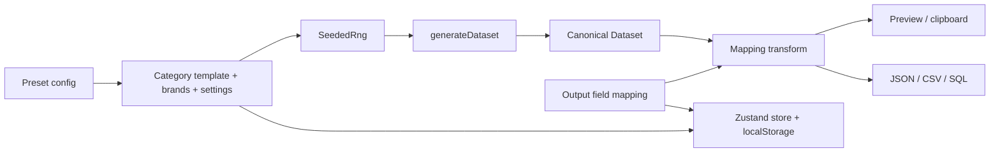

# Architecture

DataForge is a static React application. There is no backend, database, or
server-side generation: the catalog templates, seeded random generation, field
mapping, presets, previews, and exports all run in the browser.

## System overview



The core pipeline is:

```text
CategoryTemplate + Brand[] + GenerationSettings
  → SeededRng
  → generateDataset()
  → canonical Dataset
  → applyDatasetFieldMapping()
  → serializers
  → preview / clipboard / download
```

Field mapping never mutates the generated dataset. It is a serialization-only
transform applied immediately before an output is produced.

## Layering

The dependency direction is intentionally one-way:

```text
types  ←  core  ←  store  ←  components / App
                   ↑
              lib (browser adapters)
```

### `src/types`

Shared domain types only: `CategoryTemplate`, `Brand`,
`AttributeDefinition`, `GenerationSettings`, and the five dataset row types.
This layer has no runtime dependencies.

### `src/core`

Pure application logic. This layer contains no React, store access, DOM access,
or downloads.

| Area | Responsibility |
| --- | --- |
| `categories.ts` | Declarative built-in category templates |
| `rng.ts` | Seedable `Rng` wrapper around Faker |
| `generate/` | Product, customer, order, and review generation |
| `exporters/` | JSON, CSV, and SQL formatting |
| `outputSchema.ts` | Canonical field metadata, mapping transforms, validation, and case conversion |
| `outputSerialization.ts` | Mapping-aware wrappers around every exporter |
| `presets.ts` | Preset v2 schema, validation, and v1 migration |
| `builtInPresets.ts` | Bundled demo configurations |
| `normalize.ts`, `money.ts` | Shared normalization and rounding helpers |

### `src/store`

`useStore.ts` is the single Zustand store. It owns the catalog, brand selection,
generation settings, generated dataset, output mapping, and preset application.
It persists configuration under `dataforge-config` with Zustand's persistence
middleware.

### `src/lib`

Small browser-facing adapters:

- `download.ts` — trigger a text download.
- `theme.ts` — read/write the `dataforge-theme` key and set `data-theme`.
- `panelWidth.ts` — clamp, load, and persist the desktop configuration width.

### `src/components`

- `ui/` — shared primitives (`Button`, `Input`, `Select`, `Field`, etc.).
- `sidebar/` — category, brand, model, price, and attribute editors.
- `workspace/` — configuration tabs, generation settings, and the resizable
  desktop split with a mobile drawer.
- `OutputPanel.tsx` — dataset tabs, preview, view switch, exports, and export
  validation.
- `OutputFieldsInspector.tsx` — per-table field renaming and bulk naming.
- `PresetBar.tsx` — bundled preset loading and preset import/export.

`App.tsx` composes the header, configuration pane, output panel, generation
preview behavior, and theme toggle.

## Folder tree

```text
DataForge/
├── .github/workflows/deploy.yml
├── application/
│   ├── public/
│   │   ├── favicon.svg
│   │   └── og-image.png
│   ├── src/
│   │   ├── App.tsx
│   │   ├── main.tsx
│   │   ├── index.css
│   │   ├── components/
│   │   │   ├── ui/
│   │   │   ├── sidebar/
│   │   │   ├── workspace/
│   │   │   ├── OutputFieldsInspector.tsx
│   │   │   ├── OutputPanel.tsx
│   │   │   └── PresetBar.tsx
│   │   ├── core/
│   │   │   ├── categories.ts
│   │   │   ├── rng.ts
│   │   │   ├── normalize.ts
│   │   │   ├── money.ts
│   │   │   ├── outputSchema.ts
│   │   │   ├── outputSerialization.ts
│   │   │   ├── presets.ts
│   │   │   ├── builtInPresets.ts
│   │   │   ├── generate/
│   │   │   └── exporters/
│   │   ├── lib/
│   │   ├── store/
│   │   │   └── useStore.ts
│   │   └── types/
│   ├── index.html
│   ├── package.json
│   └── vite.config.ts
├── docs/
│   ├── architecture.md
│   └── plan.md
├── Dockerfile
├── docker-compose.yml
└── README.md
```

## Generation pipeline

1. A category template supplies brands, models, price ranges, dimensions,
   attributes, SKU/ID rules, and product-name interpolation.
2. `SeededRng` wraps a seeded Faker instance. Passing the same seed and
   configuration reproduces the catalog and relationships; timestamps are
   anchored to the generation time.
3. `generateProducts` creates weighted brand/model selections, prices,
   dimensions, SKUs, slugs, images, and attributes.
4. `generateCustomers` creates customer rows.
5. `generateOrders` creates orders and matching order lines using valid
   customer and product IDs.
6. `generateReviews` links reviews to both a product and a customer.
7. The result is a canonical `Dataset`:

```ts
interface Dataset {
  products: Product[];
  customers: Customer[];
  orders: Order[];
  order_lines: OrderLine[];
  reviews: Review[];
}
```

The dataset is held in memory only. It is excluded from persisted state so a
page reload returns to the preview/configuration flow rather than restoring
potentially stale generated rows.

## Output-schema transform

Canonical field metadata lives in `outputSchema.ts`:

- `RENAMEABLE_FIELDS` lists the editable top-level fields per table.
- `FIXED_FIELDS` currently marks `products.attributes` as non-renameable.
- `FieldMapping` stores only overrides:

```ts
type FieldMapping = Partial<
  Record<DatasetTable, Record<string, string>>
>;
```

On export, `applyDatasetFieldMapping` renames keys while preserving row order and
all values. Identity output is byte-identical to the unmapped output.

```text
canonical rows
  → applyFieldMapping(table, mapping)
  → mapped rows
  → JSON / CSV / SQL formatter
```

Important constraints:

- Table names remain canonical.
- The `attributes` container and its keys remain unchanged.
- CSV flattens attributes **after** top-level mapping and adds `attr_<key>`
  columns.
- SQL uses mapped column identifiers but canonical table names.
- Validation rejects blank or invalid identifiers, duplicate names within a
  table (case-insensitive), collisions with canonical names, fixed fields, and
  flattened `attr_*` columns.
- The Fields inspector and preset parser use the same validation rules.
- While any mapping is invalid, dataset copy and downloads are disabled.

## Presets and persistence

Preset format version 2 is a complete configuration:

```ts
interface DataForgePreset {
  format: 'dataforge';
  version: 2;
  category: CategoryTemplate;
  brands: Brand[];
  selectedBrands: string[];
  settings: GenerationSettings;
  outputMapping: FieldMapping;
}
```

The parser accepts version 1 presets and upgrades them with an identity mapping.
Bundled demo presets are smaller UI shortcuts (category ID plus settings), so
loading one resets the output mapping.

Store persistence also uses version 2. Version 1 state migrates to an identity
mapping; malformed mapping values fall back to identity. Persisted keys are:

- `categories`
- `selectedCategory`
- `brands`
- `selectedBrands`
- `settings`
- `outputMapping`

The generated dataset is not persisted. Theme (`dataforge-theme`) and panel
width (`dataforge-panel-width`) use separate local-storage keys.

## Output formats

| Function | Scope |
| --- | --- |
| `serializeRowsAsJson` | Active table JSON, used by preview and clipboard |
| `serializeRowsAsCsv` | Active table CSV with flattened attributes |
| `serializeDatasetAsJson` | Full dataset JSON keyed by table |
| `serializeDatasetAsSql` | Full dataset SQL inserts for Postgres or MySQL |

The SQL exporter emits tables in dependency order: `products`, `customers`,
`orders`, `order_lines`, `reviews`.

## Build, tests, and deployment

- Vite builds the static app under `application/dist`.
- `tsc -b` is part of both `typecheck` and `build`.
- Vitest covers pure logic: generators, exporters, output-schema behavior,
  presets, store migrations, theme handling, and panel-width math.
- GitHub Actions runs lint, typecheck, tests, and build on every push and pull
  request. Pushes to `main` deploy the built app to GitHub Pages.
- The default Vite base is `/DataForge/`; `BASE_PATH` can override it.
